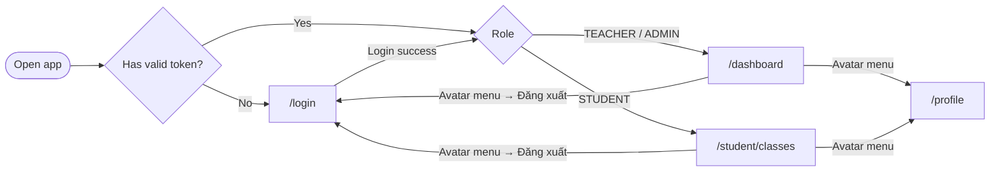
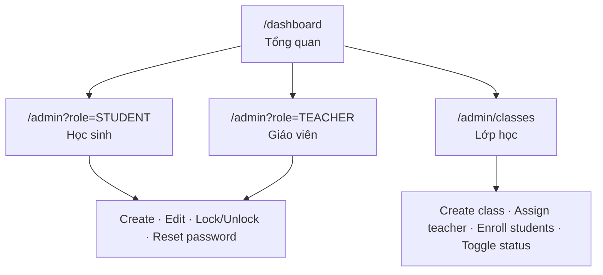
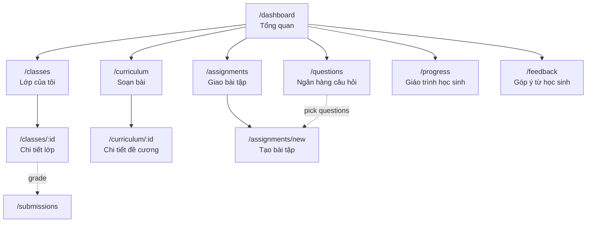
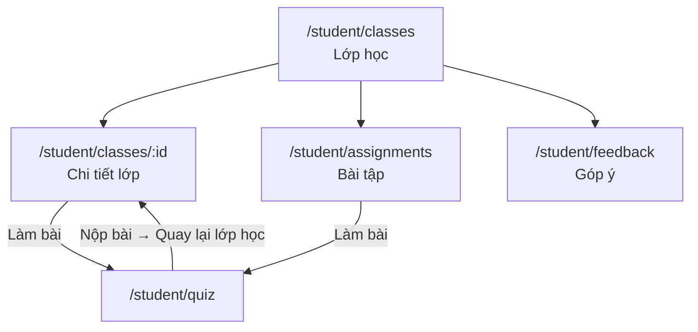
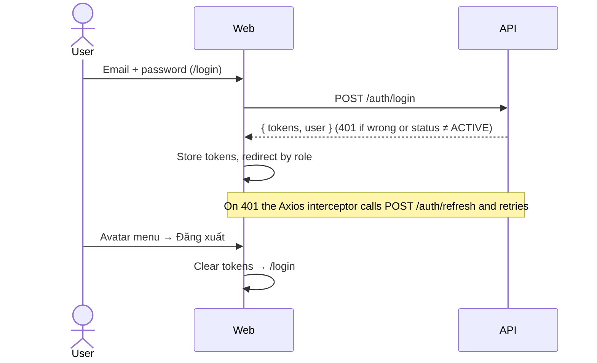
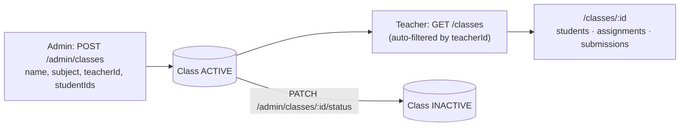
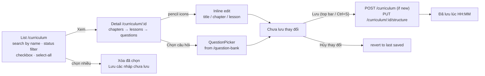
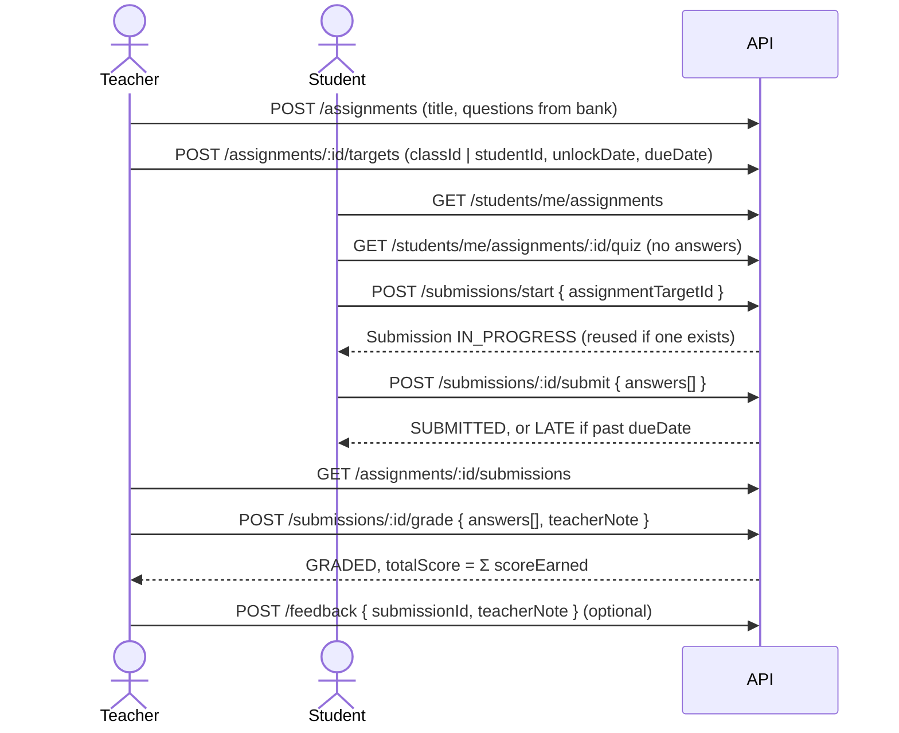
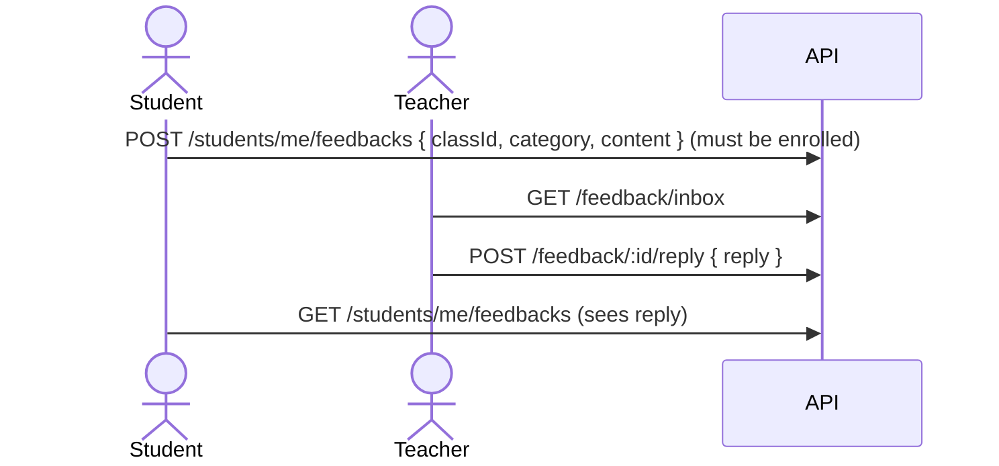

# EduConnect v2

A modular Learning Management System (LMS) built with a monorepo architecture.

## Tech Stack

| Layer       | Technology                                      |
|-------------|-------------------------------------------------|
| Backend     | NestJS, Prisma ORM, PostgreSQL 16               |
| Frontend    | React 18, Vite, TailwindCSS, shadcn/ui          |
| Auth        | JWT (access + refresh), Argon2id password hash   |
| Database    | PostgreSQL via Docker Compose + Adminer          |
| Monorepo    | pnpm workspaces                                 |
| Shared      | `@educonnect/shared` — TypeScript types package  |

## Project Structure

```
LMS-edu/
├── apps/
│   ├── api/                 # NestJS backend
│   │   └── src/
│   │       ├── common/      # Guards, decorators, filters, storage, email
│   │       ├── database/    # PrismaService, PrismaModule
│   │       └── modules/     # Domain modules (auth, users, classes, ...)
│   └── web/                 # React + Vite frontend
│       └── src/
│           ├── components/  # UI components (shadcn/ui), layouts
│           ├── contexts/    # Auth context
│           ├── lib/         # API client, utils
│           └── pages/       # Route pages
├── packages/
│   └── shared/              # Shared TypeScript types
├── prisma/
│   └── schema.prisma        # Full domain model
├── docker-compose.yml       # PostgreSQL + Adminer
├── pnpm-workspace.yaml
└── tsconfig.base.json
```

## Backend Modules

| Module         | Responsibilities                                    |
|----------------|-----------------------------------------------------|
| auth           | Login, register, JWT refresh, change password       |
| users          | CRUD users, activate/deactivate, reset password     |
| classes        | CRUD classes, enroll/remove students                |
| curriculum     | Curriculum → Chapter → Lesson (2-tier)              |
| question-bank  | CRUD questions with options                         |
| assignments    | CRUD assignments, assign to class/student           |
| submissions    | Start, submit, grade submissions                    |
| progress       | Progress snapshots, learning sessions               |
| feedback       | Teacher feedback on submissions                     |
| statistics     | Admin/teacher/student overview dashboards           |

## Page Flow

### Authentication & entry



- `/` and unknown paths redirect to `/dashboard`.
- `ProtectedRoute` redirects unauthenticated users to `/login` and blocks routes outside the user's role.
- Access token expiry is handled by the Axios interceptor via `POST /auth/refresh`.

### Admin



| Route | Page | Main APIs | Status |
|-------|------|-----------|--------|
| `/dashboard` | Admin overview | `GET /statistics/admin` | API |
| `/admin?role=…` | User management | `GET/POST/PATCH /admin/users`, `/status`, `/reset-password` | API |
| `/admin/classes` | Class management | `GET/POST /admin/classes`, `PATCH /:id/status` | API |
| `/statistics` | Statistics (URL only, not in nav) | `/admin/stats/*` | Partial — file stats stubbed |

Admins can also open every teacher route.

### Teacher



| Route | Page | Main APIs | Status |
|-------|------|-----------|--------|
| `/dashboard` | Stats + feature shortcuts | `GET /statistics/teacher`, `/classes`, `/assignments` | API |
| `/classes` | Class list (search, filter by subject) | `GET /classes` | API |
| `/classes/:id` | Students, assignments, submissions | `GET /classes/:id`, `/students`, `/assignments`, `/assignments/:id/submissions` | API |
| `/questions` | Question bank CRUD | `GET/POST/PATCH/DELETE /question-bank` | API (seed shown before load) |
| `/curriculum` | Outline list (search, saved/unsaved filter, bulk delete / bulk save) | `GET /curriculum`, `POST /curriculum`, `PUT /curriculum/:id/structure`, `DELETE /curriculum/:id` | API |
| `/curriculum/:id` | Outline detail editor (chapters → lessons → questions) | `GET /curriculum/:id`, `POST /curriculum` (first save), `PUT /curriculum/:id/structure` | API |
| `/assignments` | Assignment manager | — (`/assignments/*` exists) | Mock (`seedAssignments`) |
| `/assignments/new` | Create & assign | — (`POST /assignments`, `/targets` exist) | Mock — not persisted |
| `/progress` | Student curriculum progress | — (`/progress/*` exists) | Mock |
| `/feedback` | Feedback inbox & reply | `GET /feedback/inbox`, `POST /feedback/:id/reply` | API (mark-as-read not wired) |
| `/submissions` | Grade submissions (URL only, not in nav) | `GET /submissions`, `POST /:id/grade`, `POST /feedback` | API |

### Student



| Route | Page | Main APIs | Status |
|-------|------|-----------|--------|
| `/student/classes` | Enrolled classes + upcoming work | `GET /students/me/classes`, `/students/me/assignments` | API |
| `/student/classes/:id` | Curriculum, pending/done assignments | `GET /students/me/classes/:id` | API (mock fallback on error) |
| `/student/assignments` | All assignments by tab | `GET /students/me/assignments` | API |
| `/student/quiz` | Take quiz (opened with `state.assignmentId`; full-screen, no layout) | `GET /students/me/assignments/:id/quiz`, `POST /submissions/start`, `/:id/submit` | API (mock fallback on error) |
| `/student/feedback` | Send & view feedback | `GET/POST /students/me/feedbacks` | API |

### Navigation conventions

- **Header nav** is role-based (`roleNavItems` in `components/layouts/dashboard-layout.tsx`); profile and logout live in the avatar menu.
- **Breadcrumb + "Quay về"** (`components/layouts/page-breadcrumb.tsx`) render on every page inside `DashboardLayout`, except the role home page and `/profile`.
  - Trail: `Home › Section › Detail`, e.g. `Tổng quan › Lớp của tôi › Chi tiết lớp`.
  - "Quay về" goes back in history; when opened from a direct link it goes to the parent crumb instead.
- New pages must add a label to `staticLabels` in `page-breadcrumb.tsx` to appear in the trail.

## Feature Flows

Status legend: ✅ wired end-to-end · ⚠️ partial / known issue · ❌ UI only (not persisted) or backend stub.

### 1. Authentication ✅



- **Change password** (`/profile`): current + new + confirm (≥ 6 chars) → `POST /auth/change-password`.
- ⚠️ Logout does not call `POST /auth/logout`; refresh-token revocation is kept in memory and is lost on API restart.
- ⚠️ `mustChangePassword` is set after an admin reset but the web app does not force a password change.
- ❌ No public sign-up page; accounts are created by admins.

### 2. User management (Admin) ✅

1. `/admin?role=STUDENT|TEACHER` → `GET /admin/users`.
2. **Create**: `POST /admin/users`. If no password is given, the API returns a `temporaryPassword` for the UI to show once.
3. **Edit**: `PATCH /admin/users/:id` (name, email, role).
4. **Lock/Unlock**: `PATCH /admin/users/:id/status` → `ACTIVE | INACTIVE`. Inactive users cannot log in.
5. **Reset password**: `POST /admin/users/:id/reset-password` → new hash, `mustChangePassword = true`, a `PasswordResetLog` entry, and a temporary password returned.

- ❌ Password-reset history (`GET /admin/users/:id/reset-logs`) has no UI.
- ❌ Email delivery of credentials: `SmtpEmailService.sendMail` is a stub.

### 3. Class management ✅



- Enroll/remove students: `POST /classes/:id/students`, `DELETE /classes/:id/students/:studentId` (admin variants under `/admin/classes`).
- Students see only enrolled classes: `GET /students/me/classes`.

### 4. Question bank ✅

Teacher `/questions` → list (`GET /question-bank?limit=200`) → create/edit/delete with options and correct answers (`POST`, `PATCH`, `DELETE /question-bank/:id`). These questions are what assignments are built from.

### 5. Curriculum authoring (Soạn bài) ✅

Teacher opens **"Soạn bài"** (`/curriculum`) and sees a table of outlines. **"Xem"** opens the detail page `/curriculum/:id`.



- **Structure**: `Curriculum (outline)` → `Chapter (mục)` → `Lesson (bài)` → `LessonQuestion[]` (question ids from the bank, ordered).
- **Edit affordances**: every editable label (outline title, chapter title, lesson title) shows a pencil icon (~18 px target). Editable only after clicking it — Enter or blur commits into the local draft; Esc cancels. Remove icons (chapter / lesson / question) are ≥ 14 px with a coloured hover state.
- **Draft semantics**: creating an outline or editing a saved one marks it **Chưa lưu** — edits are kept in local state and mirrored to `localStorage` so they survive reloads and page switches, but are never sent to the API until the user presses **"Lưu"**. Pressing **"Hủy thay đổi"** discards the draft and reverts to the last saved version (for a never-saved outline it deletes it after confirmation).
- **Persist semantics**: a new outline is created on first save via `POST /curriculum`; `PUT /curriculum/:id/structure` then replaces the whole chapter/lesson/question tree in one transaction (new items get real ids, removed items are deleted). `PATCH /curriculum/:id` still supports renaming/status only.
- **List page**: accent-insensitive search by title, filter tabs `Tất cả / Đã lưu / Chưa lưu` with counts, per-row "Xem" + delete.
- **Bulk actions**: checking rows shows a bar with **Lưu** (saves every selected unsaved draft — `POST /curriculum` + `PUT /structure` for new outlines, `PUT /structure` for edited ones; already-saved rows are skipped) and **Xóa đã chọn** (confirm dialog; each `DELETE /curriculum/:id` cascades chapters → lessons → lesson questions).
- **Detail page**: sticky top bar with back button, outline title + pencil icon, stats, save indicator (`Đã lưu` / `Chưa lưu thay đổi` / `Đang lưu...` / `Lưu thất bại`) and the **Lưu** button. Above the editor sits a **Hướng dẫn nhanh** stepper card — the 4 steps (Thêm chương → Thêm bài → Chọn câu hỏi → Bấm Lưu) shown as icon tiles joined by a connector line, plus a tips footer (Ctrl+S keycap, pencil-icon hint).
- **Status flag**: the UI only surfaces two states — **Đã lưu** (no local draft) and **Chưa lưu** (local draft exists). The `Curriculum.status` column (`DRAFT`/`PUBLISHED`) remains in the schema/API but is not shown.
- Students read the published tree through `GET /students/me/classes/:id` (field `curriculum`); lesson questions power the question preview inside a lesson.

### 6. Assignment lifecycle ⚠️



Submission states: `IN_PROGRESS → SUBMITTED | LATE → GRADED`.

- ❌ Creating, editing and assigning: `/assignments` and `/assignments/new` use seed data and never call `POST /assignments` or `/targets`. Students only see assignments that already exist in the DB, e.g. from the seed.
- ⚠️ No auto-grading: multiple-choice answers are stored but scored only when a teacher grades.
- ⚠️ Grading payload mismatch: `SubmissionsPage` sends `{ scores: [{ questionId, score }] }` but the API expects `{ answers: [{ answerId, isCorrect, scoreEarned }] }`, so per-answer scores are not saved.
- ⚠️ Resubmitting replaces the previous answers of the same submission.

### 7. Student ↔ teacher feedback ⚠️



- ⚠️ `GET /feedback/inbox` is not filtered by the current teacher; every teacher sees all feedback.
- ❌ Mark as read (`PATCH /feedback/:id/read`) has no UI.

### 8. Learning progress ❌

Backend supports learning sessions (`/progress/sessions/start|end`), milestones and snapshots, but nothing calls them. Teacher `/progress` shows mock data, and the quiz does not record sessions.

### 9. Statistics ⚠️

- Dashboards: `GET /statistics/admin`, `/statistics/teacher`, `/statistics/student`.
- Admin `/statistics`: `/admin/stats/*`; `files` always returns an empty list because file tracking is not implemented.

### 10. File storage ❌

`R2FileStorageService` (`upload`, `delete`, `getSignedUrl`) only logs and returns placeholder URLs, and no module uses it. There is no upload feature yet.

## API Endpoints

All routes are prefixed with `/api/v1`. Protected routes require `Authorization: Bearer <accessToken>`. Roles in parentheses; no role = any authenticated user.

### Auth — `/auth`

| Method | Path                  | Role    | Description                          |
|--------|-----------------------|---------|--------------------------------------|
| POST   | /auth/login           | public  | Login, returns access + refresh JWT |
| POST   | /auth/register        | ADMIN   | Create user (admin only)            |
| POST   | /auth/refresh         | public  | Exchange refresh token for new pair |
| GET    | /auth/me              | any     | Current user profile                |
| POST   | /auth/logout          | public  | Revoke refresh token                |
| POST   | /auth/change-password | any     | Change own password                 |

### Users — `/users`

| Method | Path            | Role            | Description                    |
|--------|-----------------|-----------------|--------------------------------|
| GET    | /users/students | TEACHER, ADMIN  | List students (for enrollment) |

### Admin — `/admin` (all ADMIN only)

| Method | Path                              | Description                          |
|--------|-----------------------------------|--------------------------------------|
| GET    | /admin/users                      | List users (`role,status,search,page,limit`) |
| POST   | /admin/users                      | Create user                          |
| GET    | /admin/users/:id                  | User detail with classes             |
| PATCH  | /admin/users/:id                  | Update user                          |
| PATCH  | /admin/users/:id/status           | Activate/deactivate user             |
| POST   | /admin/users/:id/reset-password   | Reset user password                  |
| GET    | /admin/users/:id/reset-logs       | Password reset audit logs            |
| GET    | /admin/classes                    | List classes (`search,subject,status`) |
| POST   | /admin/classes                    | Create class                         |
| GET    | /admin/classes/:id                | Class detail with students           |
| PATCH  | /admin/classes/:id                | Update class                         |
| PATCH  | /admin/classes/:id/status         | Activate/deactivate class            |
| POST   | /admin/classes/:id/students       | Enroll students                      |
| DELETE | /admin/classes/:id/students/:sid  | Remove student from class            |
| GET    | /admin/stats/overview             | Platform overview statistics         |
| GET    | /admin/stats/growth               | User growth (`from,to,interval`)     |
| GET    | /admin/stats/questions            | Question stats (`groupBy=teacher\|subject`) |
| GET    | /admin/stats/files                | Uploaded files stats                 |

### Classes — `/classes`

| Method | Path                            | Role           | Description                        |
|--------|---------------------------------|----------------|------------------------------------|
| GET    | /classes                        | any            | List classes (admin: all, teacher: own) |
| GET    | /classes/:id                    | any            | Class detail                       |
| POST   | /classes                        | TEACHER, ADMIN | Create class                       |
| PATCH  | /classes/:id                    | TEACHER, ADMIN | Update class                       |
| PATCH  | /classes/:id/deactivate         | ADMIN          | Deactivate class                   |
| GET    | /classes/:id/stats              | TEACHER, ADMIN | Avg progress, ungraded, avg score  |
| GET    | /classes/:id/students           | any            | Enrolled students                  |
| GET    | /classes/:id/assignments        | any            | Assignments of the class           |
| POST   | /classes/:id/students           | TEACHER, ADMIN | Enroll students                    |
| DELETE | /classes/:id/students/:studentId| TEACHER, ADMIN | Remove student                     |

### Curriculum — `/curriculum`

| Method | Path                        | Role           | Description                      |
|--------|-----------------------------|----------------|----------------------------------|
| GET    | /curriculum                 | any            | List curriculums                 |
| GET    | /curriculum/:id             | any            | Curriculum with chapters/lessons |
| POST   | /curriculum                 | TEACHER, ADMIN | Create curriculum                |
| PATCH  | /curriculum/:id             | TEACHER, ADMIN | Update curriculum                |
| DELETE | /curriculum/:id             | TEACHER, ADMIN | Delete curriculum                |
| POST   | /curriculum/chapters        | TEACHER, ADMIN | Create chapter                   |
| PATCH  | /curriculum/chapters/:id    | TEACHER, ADMIN | Update chapter                   |
| DELETE | /curriculum/chapters/:id    | TEACHER, ADMIN | Delete chapter                   |
| POST   | /curriculum/lessons         | TEACHER, ADMIN | Create lesson                    |
| PATCH  | /curriculum/lessons/:id     | TEACHER, ADMIN | Update lesson                    |
| DELETE | /curriculum/lessons/:id     | TEACHER, ADMIN | Delete lesson                    |

### Question Bank — `/question-bank`

| Method | Path                | Role           | Description                              |
|--------|---------------------|----------------|------------------------------------------|
| GET    | /question-bank      | any            | List (`teacherId,subject,type,difficulty,q,page,limit`) |
| GET    | /question-bank/:id  | any            | Question with options                    |
| POST   | /question-bank      | TEACHER, ADMIN | Create question with options             |
| PATCH  | /question-bank/:id  | TEACHER, ADMIN | Update question                          |
| DELETE | /question-bank/:id  | TEACHER, ADMIN | Delete question                          |

### Assignments — `/assignments`

| Method | Path                          | Role           | Description                     |
|--------|-------------------------------|----------------|---------------------------------|
| GET    | /assignments                  | any            | List (`createdBy`)              |
| GET    | /assignments/:id              | any            | Detail with questions + targets |
| POST   | /assignments                  | TEACHER, ADMIN | Create with questions           |
| PATCH  | /assignments/:id              | TEACHER, ADMIN | Update                          |
| DELETE | /assignments/:id              | TEACHER, ADMIN | Delete                          |
| POST   | /assignments/:id/targets      | TEACHER, ADMIN | Assign to class/student         |
| GET    | /assignments/:id/targets      | any            | List targets                    |
| GET    | /assignments/:id/submissions  | TEACHER, ADMIN | List submissions                |

### Submissions — `/submissions`

| Method | Path                    | Role           | Description                    |
|--------|-------------------------|----------------|--------------------------------|
| GET    | /submissions            | any            | List (`studentId`, `targetId`) |
| GET    | /submissions/:id        | any            | Submission detail              |
| POST   | /submissions/start      | STUDENT        | Start a submission             |
| POST   | /submissions/:id/submit | STUDENT        | Submit answers                 |
| POST   | /submissions/:id/grade  | TEACHER, ADMIN | Grade submission               |

### Progress — `/progress`

| Method | Path                        | Role           | Description                |
|--------|-----------------------------|----------------|----------------------------|
| GET    | /progress/snapshots         | any            | Progress snapshots (`studentId,curriculumId`) |
| GET    | /progress/sessions          | any            | Learning sessions          |
| POST   | /progress/sessions/start    | STUDENT        | Start learning session     |
| POST   | /progress/sessions/:id/end  | STUDENT        | End learning session       |
| GET    | /progress/milestones        | any            | List milestones            |
| POST   | /progress/milestones        | TEACHER, ADMIN | Create milestone           |
| DELETE | /progress/milestones/:id    | TEACHER, ADMIN | Delete milestone           |

### Feedback — `/feedback`

| Method | Path                     | Role            | Description                  |
|--------|--------------------------|-----------------|------------------------------|
| POST   | /feedback                | TEACHER, ADMIN  | Feedback on a submission     |
| GET    | /feedback/:submissionId  | any             | Feedback for a submission    |
| POST   | /feedback/student        | STUDENT, ADMIN  | Student creates feedback     |
| GET    | /feedback/inbox          | TEACHER, ADMIN  | Teacher inbox (`isRead,studentId`) |
| PATCH  | /feedback/:id/read       | TEACHER, ADMIN  | Mark as read                 |
| POST   | /feedback/:id/reply      | TEACHER, ADMIN  | Reply to feedback            |

### Student self-service — `/students/me` (all STUDENT)

| Method | Path                            | Description                          |
|--------|---------------------------------|--------------------------------------|
| GET    | /students/me/classes            | Enrolled classes + progress          |
| GET    | /students/me/classes/:id        | Class detail (student view)          |
| GET    | /students/me/assignments        | My assignments (`status,classId`)    |
| GET    | /students/me/assignments/:id/quiz | Quiz questions (no answers)        |
| GET    | /students/me/feedbacks          | My feedback history                  |
| POST   | /students/me/feedbacks          | Send feedback to teacher             |
| GET    | /students/me/stats              | Dashboard stats                      |

### Statistics — `/statistics`

| Method | Path                | Role           | Description            |
|--------|---------------------|----------------|------------------------|
| GET    | /statistics/admin   | ADMIN          | Admin overview         |
| GET    | /statistics/teacher | TEACHER, ADMIN | Teacher overview       |
| GET    | /statistics/student | STUDENT        | Student overview       |

## Getting Started

### Prerequisites

- Node.js 20+
- pnpm 9+
- Docker (for PostgreSQL)

### Setup

```bash
# Install dependencies
pnpm install

# Start PostgreSQL
docker compose up -d

# Copy env files
cp .env.example .env
cp apps/api/.env.example apps/api/.env
cp apps/web/.env.example apps/web/.env

# Generate Prisma client + run migrations
pnpm --filter @educonnect/api prisma:generate
pnpm --filter @educonnect/api prisma:migrate

# Start API (port 3000)
pnpm --filter @educonnect/api dev

# Start Web (port 5173)
pnpm --filter @educonnect/web dev
```

### API Documentation

Once the API is running, Swagger UI is available at `http://localhost:3000/api/docs`.

## Architecture Decisions

- **Modular Monolith**: Single NestJS app with domain-based modules — no microservices.
- **Repository Pattern**: Lightweight interfaces isolate Prisma in `users` and `classes` modules.
- **JWT Auth**: Access token (15m) + refresh token (7d). Argon2id for password hashing.
- **No Redis**: Stateless JWT, no caching layer at this stage.
- **Shared Types**: `@educonnect/shared` package provides TypeScript types for both frontend and backend.

## License

Private — © EduConnect 2025
